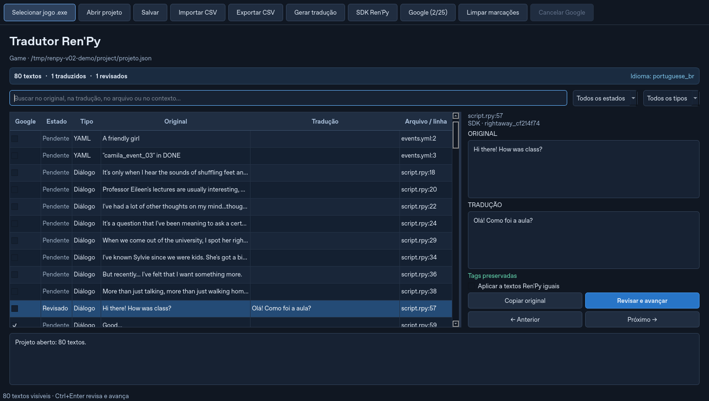

# Tradutor Ren'Py

Aplicativo desktop em português para extrair, traduzir e revisar jogos Ren'Py,
inspirado no [The Sims 4 Translator, de voky1](https://github.com/voky1/sims4-translator).



## Recursos

- Extração de arquivos RPA 2.0, 3.0 e 3.2 fora da pasta do jogo.
- Descompilação de `.rpyc` e `.rpymc` com unrpyc. `.rpcy` também é aceito como
  alternativa para um arquivo com conteúdo RPYC.
- Geração pelo **SDK oficial do Ren'Py**, usando blocos nativos de diálogo
  `translate <idioma> <identificador>`, com personagem, atributos e comandos preservados.
- Menus/interface identificados pelo SDK, com pares `old`/`new`.
- Pergunta prévia para incluir ou não os textos YAML.
- Editor com original, tradução, contexto, busca e estados de revisão.
- Google Tradutor por string: marque **até 25** textos para traduzir em sequência.
- Projetos JSON, importação/exportação CSV e exportação para instalar no jogo.

Se o jogo contém roteiros e a descompilação/geração falhar, o programa mostra
um erro em vez de criar silenciosamente um projeto contendo apenas YAML.

## Instalação

Requer Python 3.11 ou superior, uma sessão gráfica e o
[SDK oficial do Ren'Py](https://github.com/renpy/renpy/releases) extraído.
Prefira um SDK compatível com o jogo. Validado com SDK 8.5.3 e um roteiro real do Ren'Py 8.2.

Com [uv](https://docs.astral.sh/uv/):

```sh
uv sync --locked
uv run --locked renpy-translator
```

No Windows com Python/PowerShell:

```powershell
py -3 -m venv .venv
.\.venv\Scripts\python.exe -m pip install -e .
.\.venv\Scripts\python.exe -m renpy_translator
```

No Linux/macOS, use `python3 -m venv .venv`, instale com
`.venv/bin/python -m pip install -e .` e inicie com `.venv/bin/python -m renpy_translator`.

Use **SDK Ren'Py** para escolher a pasta que contém `renpy.exe` (Windows) ou
`renpy.sh` (Linux/macOS), além da pasta `renpy/`. Também é possível definir
`RENPY_SDK` com esse caminho. Sem configuração, a interface pede o SDK antes da extração.

Para instalar o SDK fixado dos testes no ambiente na nuvem:

```sh
uv run --locked python scripts/install_sdk.py --destino /workspace/renpy-sdk-cache
```

O script verifica o SHA256 publicado na release oficial e reutiliza a instalação.
Não sobrescreve uma pasta incompleta.

## Como usar

1. Selecione o `.exe` do jogo. Esta versão espera a distribuição Windows, com
   o executável e a pasta `game` no mesmo diretório.
2. Escolha uma pasta de projeto **fora da pasta do jogo** e um idioma Ren'Py,
   como `portuguese_br`.
3. Responda **Incluir textos YAML?** antes da extração e selecione o SDK quando solicitado.
4. Aguarde: o programa extrai RPA, descompila roteiros e gera modelos pelo SDK
   em um projeto utilitário separado. O executável e os blocos Python de
   inicialização do jogo não são executados.
5. A nova pasta contém `projeto.json`, `traducoes.csv` e `extraidos/`.
   Os modelos do SDK também ficam no projeto salvo.
6. Edite **Tradução** e use **Revisar e avançar** (`Ctrl+Enter`). Diálogos iguais
   podem ter traduções diferentes por contexto. Alterar um texto remove sua revisão.
7. Salve com `Ctrl+S`. Para continuar depois, abra `projeto.json`.
8. Em **Gerar tradução**, escolha todos os traduzidos ou somente os revisados.
   A saída usa `game/tl/<idioma>/<arquivo>.rpy` e cópias dos YAML traduzidos.
9. Feche o jogo, faça backup de `game` e siga o `LEIA-ME.txt` da exportação para instalar.

Os arquivos originais permanecem intactos durante extração e exportação.
Blocos sem traduções selecionadas ficam de fora da exportação; textos pendentes
mantêm o original e os comandos dos blocos incluídos são preservados.

### Campos YAML

Entram apenas valores textuais de **`name`**, **`description`** e **`condition`**,
este último somente quando o valor YAML usa **aspas simples**. A condição é incluída integralmente:

```yaml
name: Camila
description: A friendly girl
condition: '"camila_event_03" in DONE'
```

`condition: DONE`, `condition: "not DONE"`, `id`, `title` e outros campos ficam de fora.
As regras também valem em listas e documentos múltiplos. Comentários, âncoras,
números, booleanos e aspas simples dos valores editados são preservados.
Em `condition`, revise a expressão lógica e os identificadores: o Google não
valida a lógica do jogo. Traduções automáticas ficam aguardando revisão.

### Google Tradutor

Marque na coluna **Google** e clique em **Google (n/25)**. Informe o idioma de
destino, como `pt`, `en`, `es` ou `zh-CN`.

Cada texto selecionado é enviado em uma requisição separada, na ordem do projeto.
Você pode cancelar a fila; a requisição atual termina antes do cancelamento.
Resultados concluídos permanecem disponíveis para revisão e salvamento.
Textos não selecionados ficam inalterados. Para substituir traduções existentes,
o programa pede confirmação.

A integração usa `translate.googleapis.com`, sem chave de API. Ela depende de
Internet e da disponibilidade do serviço, que pode limitar requisições. Falhas
interrompem a fila, preservando os resultados e as marcações restantes.
Variáveis como `[name]`, tags `{b}…{/b}` e marcadores printf são protegidos;
respostas que perdem marcadores não são aplicadas. Limite: 5000 caracteres por string.

### CSV e projetos anteriores

Exporte CSV, edite `traducao` e importe novamente. Preserve `id` e `original`.
`revisado` aceita `sim` ou `nao`. O arquivo usa UTF-8 com BOM e separador vírgula.
**Exportar CSV** gera a versão atualizada após suas edições.

Projetos 0.1 continuam abrindo para consultar suas traduções. Para exportar os
blocos nativos novos, reextraia o jogo com o SDK em uma nova pasta. O projeto
antigo é preservado; ele não contém os modelos necessários à exportação nova.

## Linha de comando

```sh
uv run renpy-translator-cli extrair /jogos/Jogo.exe --projeto /projetos/jogo --sdk /sdks/renpy-sdk --idioma portuguese_br --incluir-yaml
uv run renpy-translator-cli exportar-csv /projetos/jogo/projeto.json /projetos/textos.csv
uv run renpy-translator-cli importar-csv /projetos/jogo/projeto.json /projetos/textos.csv
uv run renpy-translator-cli exportar /projetos/jogo/projeto.json --destino /traducoes/jogo --somente-revisados
```

YAML fica desligado por padrão na CLI: use `--incluir-yaml` para habilitar.
Os destinos devem ser pastas novas. `--nao-ativar` evita forçar o idioma inicial.

## Desenvolvimento e testes

```sh
uv sync --locked --extra dev
export RENPY_SDK=/workspace/renpy-sdk-cache/renpy-8.5.3-sdk
uv run --locked --extra dev ruff check src tests scripts
uv run --locked --extra dev ruff format --check src tests scripts
QT_QPA_PLATFORM=offscreen XDG_CACHE_HOME=/tmp/renpy-translator-cache uv run --locked --extra dev pytest
```

Os testes exercitam RPA, RPYC e SDK reais, diálogos por contexto, filtros YAML,
a pergunta da interface, persistência, exportação e a fila Google. Os testes
Google usam respostas simuladas. Sem `RENPY_SDK`, os testes de integração com o
SDK são pulados. O workflow GitHub instala o SDK para executar esses testes.
A distribuição Windows deve ser validada no Windows.

## Aplicativo distribuível

No Windows:

```powershell
uv sync --locked --extra bundle
uv run --locked --extra bundle python scripts/build_desktop.py
```

Distribua toda a pasta `dist/TradutorRenpy/`, incluindo `worker/`. O SDK é
selecionado separadamente. PyInstaller gera o aplicativo para o sistema do build.

## Compatibilidade e créditos

Arquivos devem estar em UTF-8. RPA personalizados, roteiros obfuscados e comandos
próprios podem exigir suporte adicional. O programa mostra os erros de análise;
não executa código do jogo para registrar comandos customizados. Traduções já
instaladas no mesmo idioma podem conflitar com os blocos exportados.

O fluxo visual é inspirado no projeto de voky1. O código da aplicação é próprio.
A descompilação usa [unrpyc](https://github.com/CensoredUsername/unrpyc), com origem,
commit e licenças em `src/renpy_translator/_vendor/unrpyc/`.
A geração nativa usa as APIs de tradução do [SDK Ren'Py](https://github.com/renpy/renpy).
